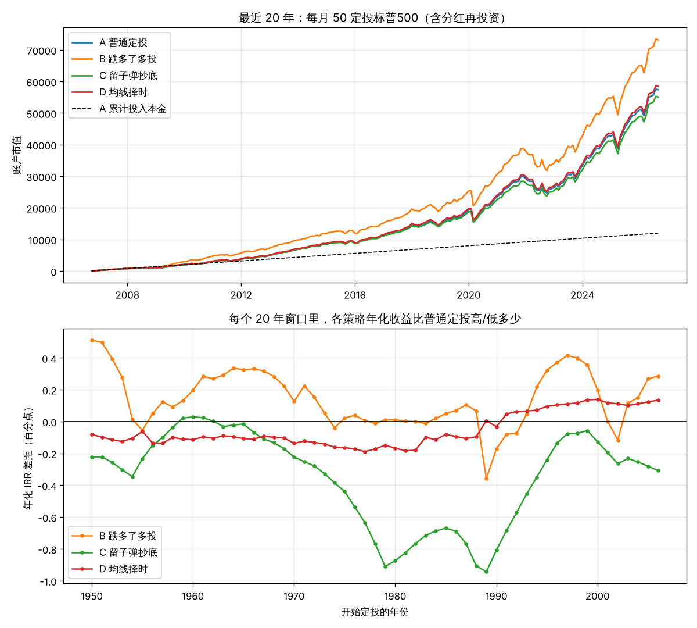

# 标普500 定投策略回测

用标普500历史数据（1900–2026，含分红再投资），对比四种"每月投 50"的方式：

| 策略 | 规则 |
|---|---|
| **A 普通定投** | 每月固定投 50，什么都不管 |
| **B 跌多了多投** | 平时投 50；指数比历史高点跌超 20% 时当月投 100（需要额外掏钱） |
| **C 留子弹抄底** | 预算同样每月 50：平时投 40、存 10；跌超 20% 时把攒的现金一次性投进去 |
| **D 均线择时** | 预算同样每月 50：指数在 10 个月均线上方才投，跌破就存现金 |

## 运行

```bash
pip install pandas numpy matplotlib
python3 backtest.py
```

结果打印在终端，图保存在 `output/backtest.png`。

## 结果（数据截至 2026-09）

**最近 20 年（2006-10 ~ 2026-09）**

| 策略 | 累计投入 | 期末市值 | 年化 IRR |
|---|---:|---:|---:|
| A 普通定投 | 12,000 | 57,382 | 13.91% |
| B 跌多了多投 | 13,600 | 73,156 | 14.13% |
| C 留子弹抄底 | 12,000 | 55,091 | 13.57% |
| D 均线择时 | 12,000 | 58,406 | 14.05% |

**最近 30 年（1996-10 ~ 2026-09）**

| 策略 | 累计投入 | 期末市值 | 年化 IRR |
|---|---:|---:|---:|
| A 普通定投 | 18,000 | 123,584 | 10.93% |
| B 跌多了多投 | 21,800 | 164,498 | 11.15% |
| C 留子弹抄底 | 18,000 | 120,676 | 10.81% |
| D 均线择时 | 18,000 | 124,856 | 10.98% |

**1950 年以来所有 20 年定投窗口（57 个）**

| 策略 | IRR 中位数 | 跑赢 A 的比例 | 平均年化差距 |
|---|---:|---:|---:|
| A 普通定投 | 10.30% | – | – |
| B 跌多了多投 | 10.55% | 82% | +0.14 个百分点 |
| C 留子弹抄底 | 9.89% | 7% | −0.35 个百分点 |
| D 均线择时 | 10.40% | 30% | −0.05 个百分点 |



## 结论

1. **普通定投已经很好了。**过去 20 年每月 50、本金 1.2 万，滚到约 5.7 万。
2. **"留子弹等抄底"（C）长期几乎总是更差。**在相同预算下，它在 93% 的 20 年窗口里输给普通定投：现金闲置的成本，比偶尔抄到底赚的更多。
3. **均线择时（D）和普通定投基本打平**，有时好有时差，不值得为此增加复杂度。
4. **"跌多了多投"（B）年化只高约 0.1–0.2 个百分点**，多出来的市值主要是因为多投了钱。前提是你下跌时真有闲钱、而且真敢投。

## 假设与局限

- 数据：Robert Shiller 月度数据（[datasets/s-and-p-500](https://github.com/datasets/s-and-p-500)），价格为月度平均值。2023-07 之后数据源缺分红，用最后已知股息率补齐。
- 不计交易费用、税、汇率；现金不计利息（对 C、D 略不利）。
- 收益为名义收益，未扣通胀。
- 历史回测不代表未来表现，本项目仅供学习，不构成投资建议。
